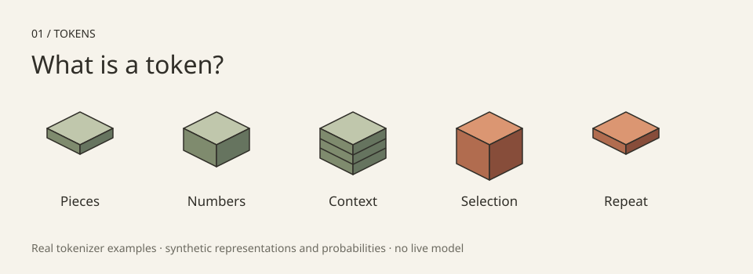

# 01 / What is a token?

A small, fixed-fixture walk from text to token IDs, numerical representations, next-token selection, and text again. This is a teaching illustration of a decoder-only language model, **not a model or benchmark**.



Companion: [What is a token?](https://stethem.com/learning-machines/tokens/).

## Run

Node.js 18+, no dependencies, network requests or model weights:

```sh
node experiments/tokens/run.mjs
node experiments/tokens/run.mjs --sample
node experiments/tokens/run.mjs --sample --seed 600     # any uint32 seed; prints each draw
node experiments/tokens/run.mjs --seed 600 --draws 500  # 500 chained draws, counted
node --test experiments/tokens/
```

`--seed` and `--draws` reproduce the companion page's sampling playground exactly: the same seed gives the same draw (`selection.seed / 2^32`), and `--draws` chains each draw's returned seed into the next, as "Draw 100 in a row" does.

## What is real?

`fixture.mjs` contains actual **tiktoken 0.14.0 / cl100k_base** tokenization, including spaces. It is not Qwen tokenization. For example, `The cat sat on the` has IDs `[791, 8415, 7731, 389, 279]`; `unhappiness` splits into `un`, `h`, `appiness`. IDs are vocabulary labels, not quantities or meanings.

No tokenizer runs in the browser. `decode` only supports the individually UTF-8-decodable tokens recorded in this fixture; it rejects unknown IDs. It is not a general-purpose text encoder or decoder.

The explicit six-component lookup, one toy processing block and probabilities are **invented teaching data**. They are not a trained network, embeddings from a model, measured confidence, or observed outputs. The real process uses learned weights and position information to transform representations, then turns final-position vocabulary scores (logits) into a probability distribution. Generation settings can alter selection; likelihood is not truth confidence.

## Mechanics API

- `createState({mode: 'greedy' | 'sample', seed: uint32})`: start at `tokens` with the fixed prompt.
- `PHASES`: `tokens → embedding → layers → distribution → append`.
- `step(state)`: immutable stage transition. Entering `append` selects and appends one known token. Leaving it starts another cycle, or stops after two appended tokens.
- `distributionFor(state)`: synthetic first-step probabilities (mat 45%, floor 25%, sofa 15%, all other tokens 15%). The second step is explicitly scripted punctuation (`.` at 100%), not a model prediction.
- `chooseToken(distribution, {mode, seed})`: highest individual candidate for this fixture, or deterministic LCG sample (not cryptographic randomness).
- `matricesFor(state)`: fixed lookup `input`, one-block `contextual` outputs, `attentionWeights` and `afterAttention` arrays aligned to the current token count.
- `traceFor(state, rowIndex = state.ids.length - 1)`: the selected row’s coefficients, contributions, intermediate values and both residual additions.
- `causalWeights(rowIndex, length)`: fixed normalized coefficients for one to seven tokens.
- `reset(state)`: replay with the original mode and seed.
- `decode(ids)`: join known fixture pieces, including their leading spaces.

“All other tokens” is an aggregate, **not a token**. Sampling it stops with `outside-fixture`, leaves the prompt unchanged and appends no fake ID. A real model would sample a particular token from its full vocabulary. The ordinary two-token stop is `demo-limit`, not a fabricated end-of-sequence prediction. A real generation loop continues until a stopping rule, token limit or end token; caching can avoid reprocessing all previous tokens. Tokenizers may need to buffer byte fragments before displaying text.

The website owns rendering, controls and editorial copy. It should pin both `mechanics.mjs` and `fixture.mjs` to the same commit and verify SHA-256 hashes. It must keep the synthetic-data labels visible and explain `outside-fixture` without pretending an answer was generated.

## The explicit teaching calculation

`EMBEDDINGS` is a fixed table indexed by token ID. IDs select vectors; they do not mathematically encode their meaning. The six components preserve the first illustration’s values, but the former ID-based formula and arbitrary contextual update have been removed. Repeated IDs look up the same vector.

For selected row `r`, gather rows `0…r`, including itself. Fixed coefficients favor recent rows: the five-token final row uses `[1/16, 1/16, 1/8, 1/4, 1/2]`. Rows after `r` have zero weight. Each coefficient multiplies all six components of its source row:

```text
contributions[i][j] = weights[i] × input[i][j]
contextMix[j]       = sum_i contributions[i][j]
attentionDelta[j]   = 0.5 × contextMix[j]
afterAttention[j]   = input[r][j] + attentionDelta[j]

mlpPreactivation[j] = sum_k afterAttention[k] × MLP_MATRIX[k][j]
mlpActivation[j]    = max(0, mlpPreactivation[j])
mlpDelta[j]         = 0.25 × mlpActivation[j]
output[j]          = afterAttention[j] + mlpDelta[j]
```

The same fixed 6×6 matrix processes **every row independently after context gathering**. Its diagonal is 0.5 and its cyclic neighbor is 0.25; other entries are zero. This makes two different operations visible: gather information across tokens, then mix components within one row. Both keep the incoming representation through a residual addition.

For the prompt’s final row, component 0 is `-0.2 + 0.021875 = -0.178125`, then `-0.178125 + 0.0099609375 = -0.1681640625`. `traceFor` exposes all terms, not just the before/after colors. Arithmetic is rounded to ten decimal places to suppress binary floating-point tails; UI displays should retain enough digits for exact equations or explicitly mark shorter values as rounded. Tests compare equations within `1e-10`.

**This is not trained transformer attention or a full transformer block.** Coefficients are fixed, not derived from query/key scores; the value/output projections, normalization, positional encoding and a full learned feed-forward network are omitted. The row transform is deliberately small and hand-authored. Identical repeated vectors can therefore remain identical even at different positions. `attentionDelta` and `mlpDelta` are API labels for these simplified teaching stages, not claims of real model activations.

The next-token distribution remains the separate scripted 45/25/15/15 example. It is **not computed from these toy output vectors**. Neither the matrices nor the probabilities are measurements or actual model inference.

## Reproduce the tokenizer fixture

This optional verification installs a tokenizer, **not a model**. Its first encoding load may download a tokenizer vocabulary. Normal demos and tests do not download anything.

```sh
python3 -m venv .venv
.venv/bin/pip install tiktoken==0.14.0
.venv/bin/python experiments/tokens/regenerate_fixture.py
git diff --exit-code -- experiments/tokens/fixture.mjs
```

The generator verifies full-string round trips. Tests also lock the prompt IDs, subword pieces, staged loop, immutable history, reset, bounded stopping, seed reproducibility, aggregate handling and invalid controls.

## Sources and license

- [OpenAI tiktoken](https://github.com/openai/tiktoken): actual tokenization via the named package and encoding. No tokenizer implementation or full vocabulary is vendored.
- [Transformers LLM tutorial](https://huggingface.co/docs/transformers/main/en/llm_tutorial): tokenization, decoding and generation.
- [Generation strategies](https://huggingface.co/docs/transformers/main/en/generation_strategies): greedy selection and sampling.

Original mechanics, examples, preview and tests are MIT licensed under the repository license. No model outputs, weights or paid calls were used.
